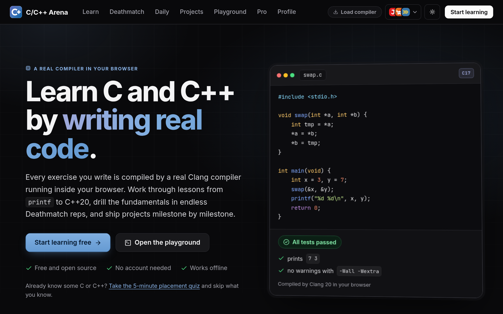
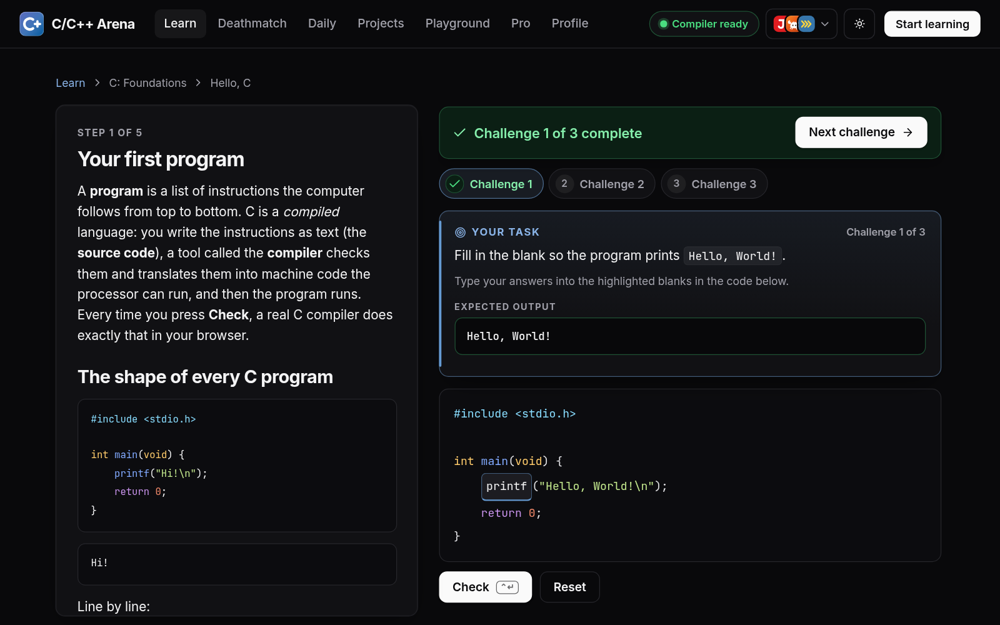
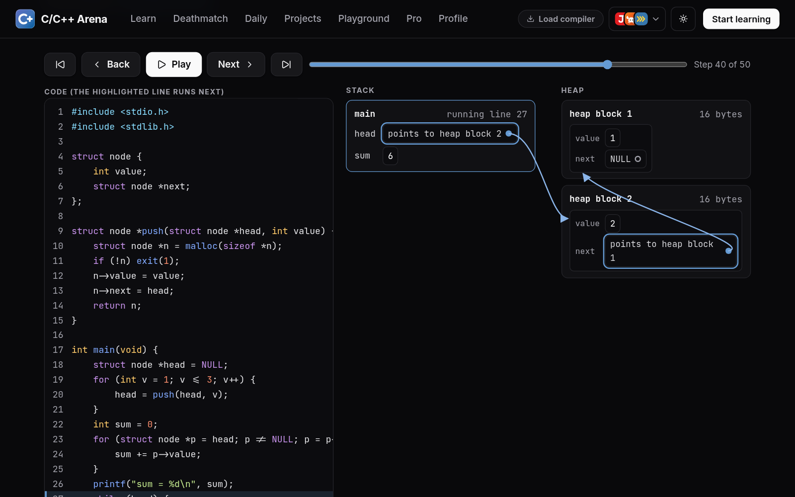
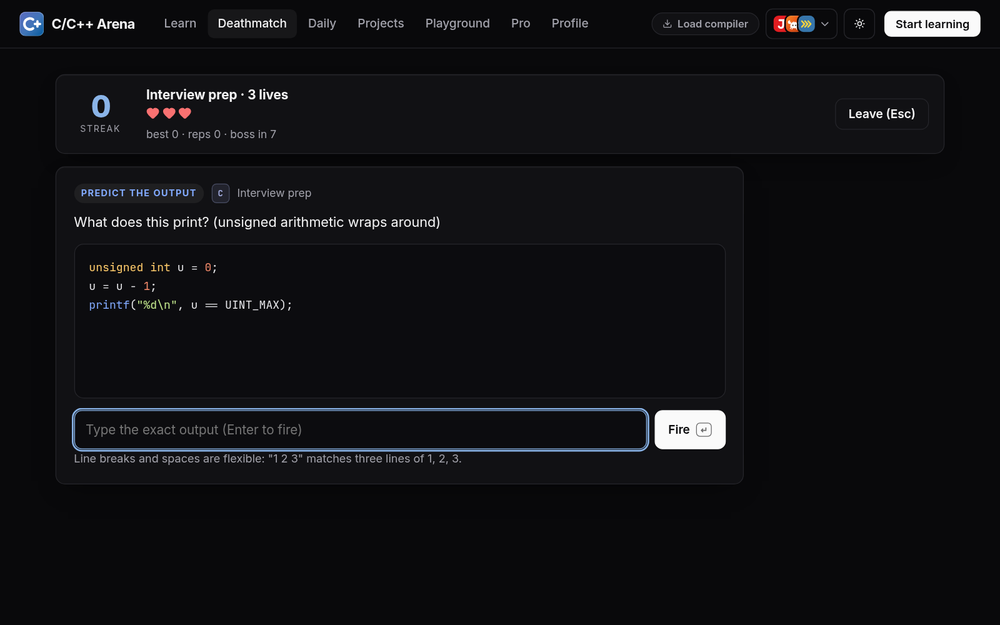
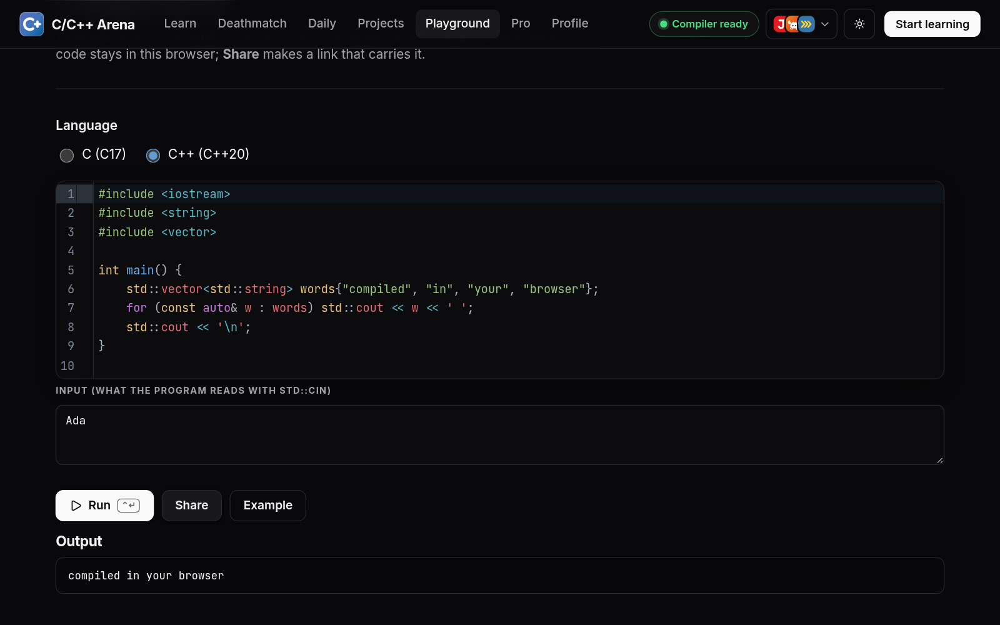
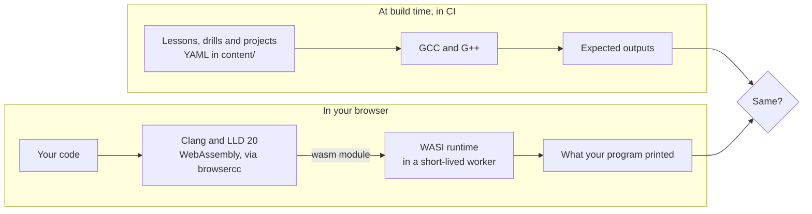

<div align="center">

<a href="https://cpparena.com"></a>

# C/C++ Arena

**Learn C and C++ by writing real code.**

A real Clang 20 compiler, compiled to WebAssembly and running in your browser.<br>
From `printf` to professional C++. No backend, no account, works offline.

[**Start learning**](https://cpparena.com) &nbsp;·&nbsp; [All modules](https://cpparena.com/learn) &nbsp;·&nbsp; [Playground](https://cpparena.com/playground) &nbsp;·&nbsp; [Watch code run](https://cpparena.com/visualize) &nbsp;·&nbsp; [How it works](#how-it-works) &nbsp;·&nbsp; [Run it locally](#quick-start)

[](https://cpparena.com)
[](https://github.com/AntonyPerez0/cpp-arena/actions/workflows/deploy.yml)
[](https://en.cppreference.com/w/c/17)
[](https://en.cppreference.com/w/cpp/20)
[](https://clang.llvm.org)
[](#how-it-works)
[](https://react.dev)
[](https://www.typescriptlang.org)

<a href="https://cpparena.com">
  <picture>
    <source media="(prefers-color-scheme: dark)" srcset="docs/images/hero-dark.png">
    <source media="(prefers-color-scheme: light)" srcset="docs/images/hero-light.png">
    
  </picture>
</a>

| 48 | 318 | 954 | 657 | 11 | 12 | 30 |
|:---:|:---:|:---:|:---:|:---:|:---:|:---:|
| modules | steps | challenges | Deathmatch drills | guided projects | Pro Track projects | visualizations |

</div>

## Why C/C++ Arena

- **A real compiler, not a look-alike.** Everything you submit is compiled by Clang 20 with `-Wall -Wextra`, as C17 or C++20, and compiler errors come with plain-English explanations.
- **Everything happens on your device.** The compiler runs as WebAssembly in a Web Worker and your program runs on a WASI runtime. There is no server: the site is static and works offline once visited.
- **See what the memory does.** 30 visualizations step through real programs line by line and draw the stack, the heap and every pointer as an arrow. They are recorded from actual runs under gdb.
- **From zero to professional.** C first, then C++, then professional C++, data structures and algorithms, and a Pro Track on a real machine with CMake, gdb, sanitizers and GoogleTest.

## What's inside

| Feature | What you get |
|---|---|
| **Course** | 48 modules and 318 steps, from `printf` to C++20. Early steps are fill-in-the-blank; later steps have you write most of the code. Every step has hints you reveal one at a time and a "show solution" escape hatch. |
| **Deathmatch** | 657 quick drills, including 62 classic interview questions: predict the output, fill the token, spot the bug, will it compile. Each drill unlocks when you finish the lesson step that teaches it, and every 8th rep is a compiled boss rep. One life, three lives, a spaced-review warm-up or interview prep, with ranks from Silver I to The Global Elite. |
| **Projects** | 11 multi-milestone builds, from a calculator and a text adventure to a dynamic array, a matrix library, your own `vector<T>`, an expression interpreter and a memory allocator. Your code carries forward between milestones. |
| **Pro Track** | 12 projects on a real machine (GitHub Codespaces or Linux/macOS): CMake, Git and pull requests, gdb and sanitizers, GoogleTest graded by mutation testing, threads and ThreadSanitizer, clang-tidy, profiling, POSIX processes and sockets, and two capstones. Each is graded by GitHub Actions in your own repository. See [`pro-track/`](pro-track/README.md). |
| **Watch code run** | Step forward and back through a program and watch its variables, stack frames and heap blocks change, with an arrow for every pointer. Linked from the lesson steps they explain. |
| **Playground** | Run any C or C++ program with your own input, see compiler errors explained and crashes described, and share it as a link that carries the code. |
| **Topics** | 52 short reference pages on the core ideas, each with a compiled and tested example, plus a "Where to go next" page of books, practice sites and projects. |
| **Daily challenge, placement quiz and certificates** | One problem a day with a streak, a 16-question quiz that lets experienced learners skip ahead, and printable certificates for finishing the course and the Pro Track. |
| **Comfort** | Light and dark themes, adjustable text size, a symbol bar for phone keyboards, "Report a problem" on every exercise, and a question before the compiler downloads on mobile data. |
| **Your progress** | Saved in the browser. Move it between devices with a transfer link, a QR code, a private GitHub Gist or a file. |

Every feature is described in detail in [`docs/architecture.md`](docs/architecture.md).

## Screenshots

<table>
  <tr>
    <td width="50%" valign="top">
      <a href="docs/images/lesson.png"></a>
      <br><sub><b>Lessons.</b> A short lesson and three challenges per step, compiled and run on your device.</sub>
    </td>
    <td width="50%" valign="top">
      <a href="docs/images/visualizer.png"></a>
      <br><sub><b>Watch code run.</b> The stack, the heap and an arrow for every pointer, one line at a time.</sub>
    </td>
  </tr>
  <tr>
    <td width="50%" valign="top">
      <a href="docs/images/deathmatch.png"></a>
      <br><sub><b>Deathmatch.</b> Endless quick drills with lives, streaks and boss reps.</sub>
    </td>
    <td width="50%" valign="top">
      <a href="docs/images/playground.png"></a>
      <br><sub><b>Playground.</b> Run any C or C++ program with your own input and share it as a link.</sub>
    </td>
  </tr>
</table>

## How it works



- **Compiler.** [browsercc](https://github.com/BertalanD/browsercc): Clang and LLD 20 compiled to WebAssembly. C is built with `-std=c17 -O1 -Wall -Wextra` and C++ with `-std=c++20 -O2 -fwasm-exceptions -Wall -Wextra`.
- **Running.** Each run happens in a short-lived worker with [`@bjorn3/browser_wasi_shim`](https://github.com/bjorn3/browser_wasi_shim). Input is supplied up front, output is capped at 64 KB and the worker is killed after 3 seconds, so an endless loop can't freeze the page.
- **C++ exceptions.** libc++, libc++abi and libunwind are rebuilt with WebAssembly exception handling, so C++ exceptions work in the browser.
- **Grading.** Output steps compare your program's output with test cases, some of them hidden. Function steps append a hidden `main()` that calls your code.
- **Visualizations.** A gdb script steps each program and records every stack frame's variables, the live heap blocks and the output so far.
- **Content.** The build compiles and runs every lesson solution, drill and project milestone with GCC, and fails if any expected output is wrong.

| Measure | Result |
|---|---|
| Compiler download for C | about 27 MB, once, then cached |
| Compiler download for C++ | about 38 MB, once, then cached |
| Warm C++ compile | about a second |
| Time limit per run | 3 seconds |

<sub>[`docs/architecture.md`](docs/architecture.md#how-it-works) has the full write-up, with the [known limits](docs/architecture.md#known-limits) of running C and C++ in a browser.</sub>

## Curriculum

<details>
<summary><b>48 modules</b>: C, C++, professional C++, data structures and algorithms, and a capstone</summary>

<br>

| Phase | Modules | Topics |
|---|:---:|---|
| C: Foundations | 1 to 7 | Hello, C, variables and types, operators and math, reading input, making decisions, loops, functions |
| C: Memory | 8 to 14 | Arrays, strings, pointers, structs, enums and `typedef`, dynamic memory, linked data structures, bits and the preprocessor |
| C: Real-World C | 15 to 18 | Files, function pointers and callbacks, integer types and undefined behavior, organizing programs |
| C++: A Better C | 19 to 24 | From C to C++, references and functions, `vector` and `string`, classes, lifetime and RAII, operator overloading |
| C++: Standard Library | 25 to 28 | `map`, `set` and friends, streams and formatting, algorithms and lambdas, more of the STL |
| C++: Modern and Advanced | 29 to 34 | Smart pointers, move semantics, templates, inheritance and polymorphism, modern C++ (17 and 20), handling errors |
| C++: Professional C++ | 35 to 40 | Writing iterators and containers, variadic templates and type traits, formatting, time and text, design patterns, threads and concurrency, performance and the machine |
| Data Structures and Algorithms | 41 to 47 | Complexity and searching, sorting, hash tables, trees and heaps, graphs, recursion and backtracking, dynamic programming |
| Capstone | 48 | Code review |

</details>

## Quick start

Tested with Node 22, the version CI uses.

```bash
git clone https://github.com/AntonyPerez0/cpp-arena.git
cd cpp-arena
npm install        # also copies the Clang toolchain into public/toolchain
npm run dev        # http://localhost:5173/
```

| Script | What it does |
|---|---|
| `npm run dev` | Starts the dev server |
| `npm run content` | Rebuilds the generated content from `content/**/*.yaml`, compiling and running everything with GCC and G++, then records the visualizations with gdb |
| `npm run verify:wasm` | Cross-checks all content against the exact browser toolchain |
| `npm run build` | Type-checks and builds `dist/`, with one pre-rendered page per route |
| `npm run test:e2e` | Drives the real UI in headless Chromium, including axe accessibility scans and SEO checks |
| `npm run check:pro` | Checks every Pro Track grader: the starter must fail and the reference solution must pass |

More on each script, and how to deploy your own copy to GitHub Pages, is in [`docs/development.md`](docs/development.md).

## Quality gates

[`deploy.yml`](.github/workflows/deploy.yml) builds and tests every pull request and every push to `main`, and publishes to GitHub Pages only after the first two of these pass:

- **Content build**: every lesson solution, drill and project milestone compiles and runs with GCC and G++, and every expected output must match.
- **Browser tests**: the real UI in headless Chromium, with axe (WCAG 2.2 AA) on every page type in both themes and on interactive states.
- **Lighthouse**, on pull requests: five key pages scored as a phone would, failing below 80 for performance or 95 for accessibility, best practices and SEO.
- **Pro Track graders**, when `pro-track/` changes: the untouched starter must fail and the starter plus its solution must pass.
- **Outside links**, every Monday: broken links are collected in one issue, which closes once they all work again.

## Project layout

```
content/      Lessons, drills, projects, topics and visualizations (YAML)
pro-track/    The Pro Track: starter repository, graders and reference solutions
scripts/      Content build, visualization recorder, pre-rendering and browser tests
src/          The site (React, TypeScript): pages, editor, grader, compiler workers
vendor/       libc++ rebuilt with WebAssembly exception handling
docs/         Architecture, development notes and the content formats
```

## Documentation

| Document | What's in it |
|---|---|
| [Architecture](docs/architecture.md) | Every feature of the site, how compiling, running and grading work, accessibility, SEO and the known limits |
| [Development](docs/development.md) | Running locally, the scripts and deploying to GitHub Pages |
| [Writing content](docs/authoring.md) | The YAML formats of lessons, drills, projects, topics and visualizations |
| [The Pro Track](pro-track/README.md) | For maintainers: the starter repository, the reference solutions and how the graders are checked |

## The Arena sites

C/C++ Arena is one of four sites that teach a language the same way, free.

| Site | Teaches | Source |
|---|---|---|
| **[C/C++ Arena](https://cpparena.com)** | C and C++ | this repository |
| [Java Arena](https://javaarena.com) | Java | [Java-Arena](https://github.com/AntonyPerez0/Java-Arena) |
| [RustArena](https://rustarena.app) | Rust | [RustArena](https://github.com/AntonyPerez0/RustArena) |
| [Python Arena](https://pythonarena.org) | Python | [pythonarena](https://github.com/AntonyPerez0/pythonarena) |

## Feedback

Found a mistake in a lesson, or a program that behaves differently than it should? Every exercise on the site has a "Report a problem" link, or you can [open an issue](https://github.com/AntonyPerez0/cpp-arena/issues/new) here.

## Credits

The compiler is [browsercc](https://github.com/BertalanD/browsercc), which packages [LLVM](https://llvm.org)'s Clang and LLD for the browser. Programs run on [`@bjorn3/browser_wasi_shim`](https://github.com/bjorn3/browser_wasi_shim). The editor is [CodeMirror](https://codemirror.net), the fonts are Inter and JetBrains Mono, and the icons come from [Lucide](https://lucide.dev).
